# Deltarune Screensaver

Un écran de veille fan-made inspiré de **DELTARUNE**, pour **Ubuntu / GNOME sous Wayland**.
12 scènes animées en pixel art, une par lieu des chapitres 1 à 5, qui se relaient toutes les 3 minutes.

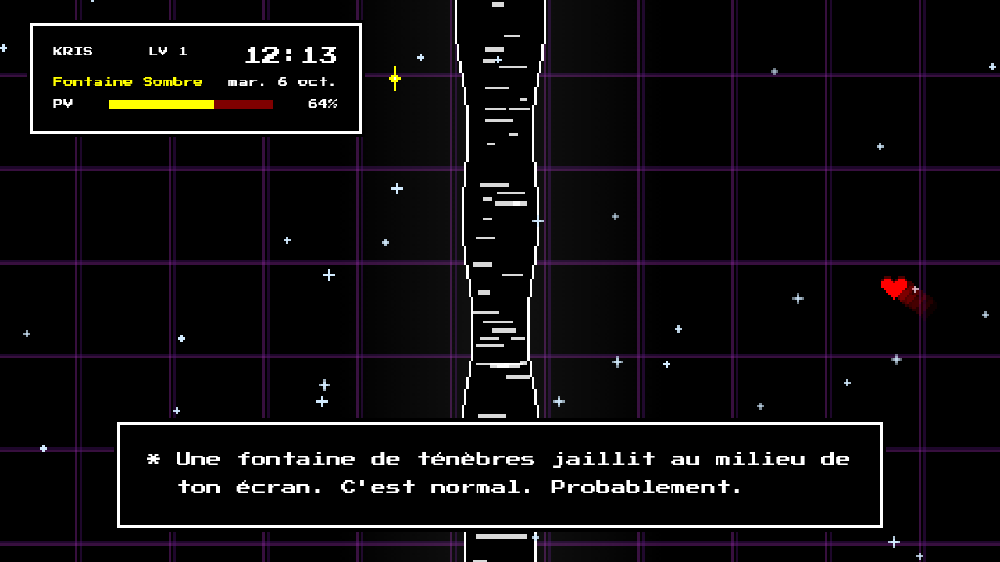

## Les scènes

| | |
|---|---|
|  **Fontaine Sombre** | 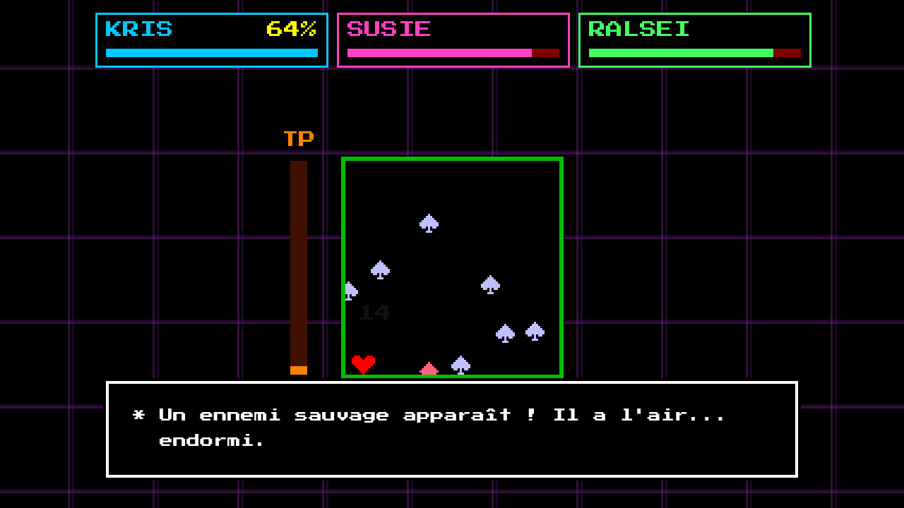 **Combat** – l'âme esquive toute seule |
| 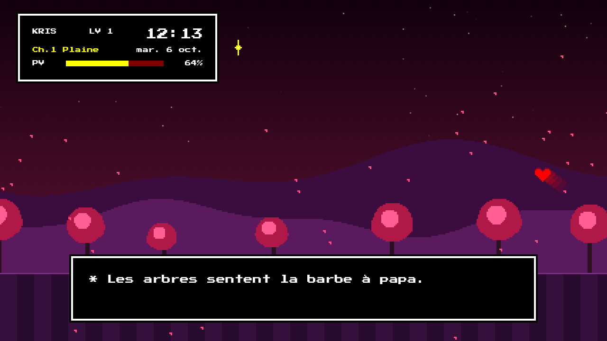 **Ch.1 Plaine** | 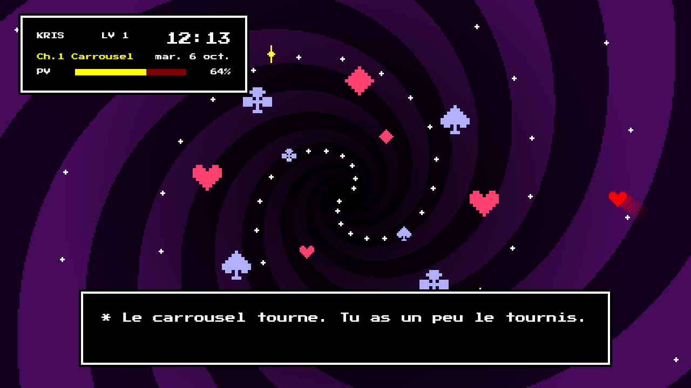 **Ch.1 Carrousel** |
| 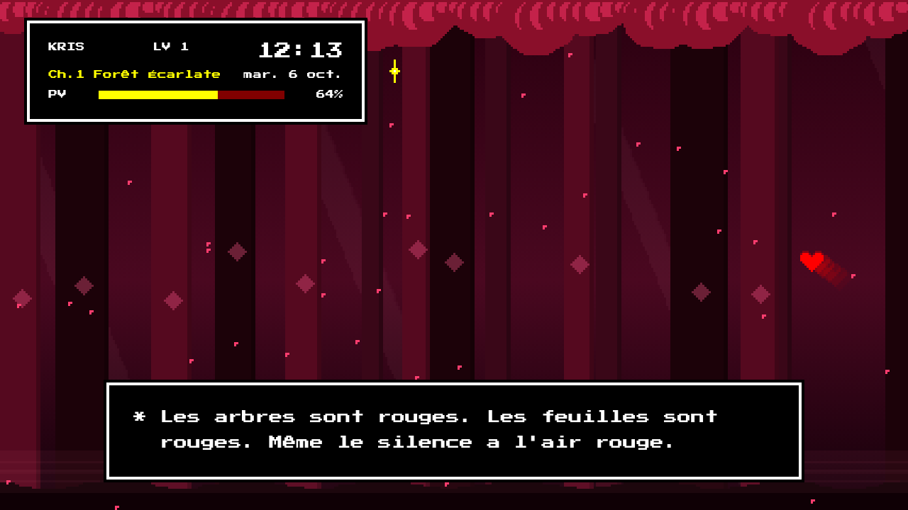 **Ch.1 Forêt Écarlate** | 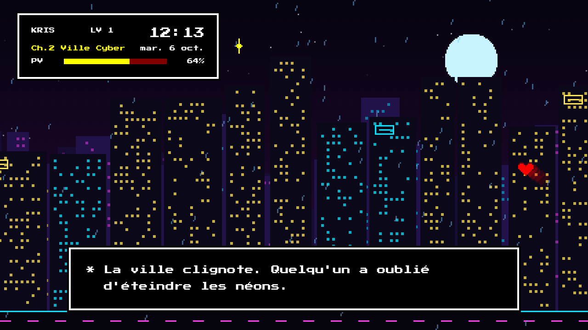 **Ch.2 Ville Cyber** |
| 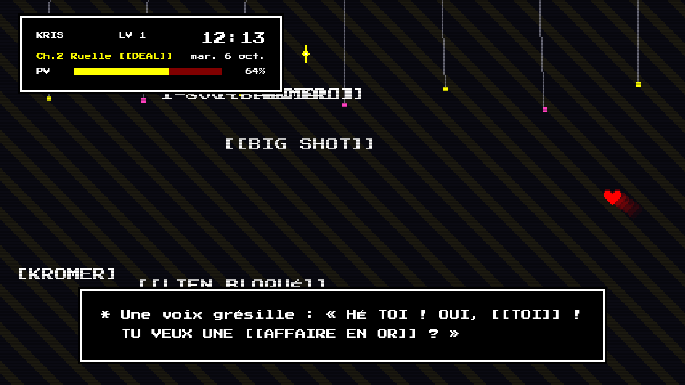 **Ch.2 Ruelle [[DEAL]]** | 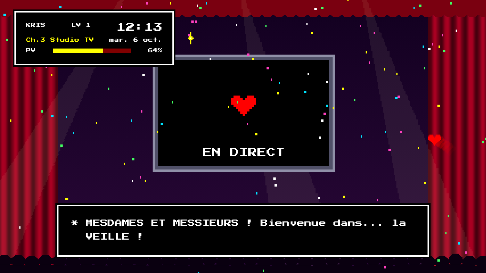 **Ch.3 Studio TV** |
| 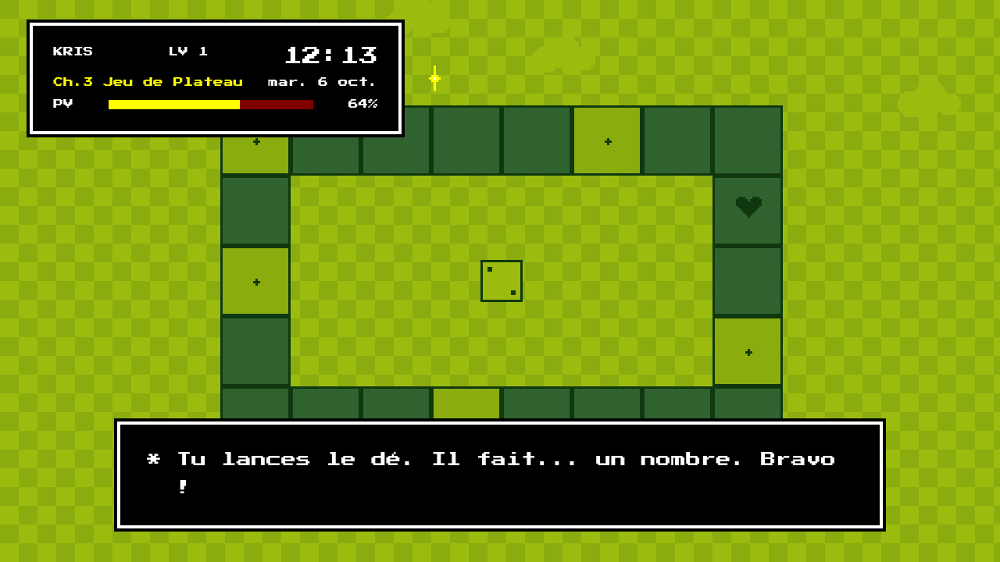 **Ch.3 Jeu de Plateau** | 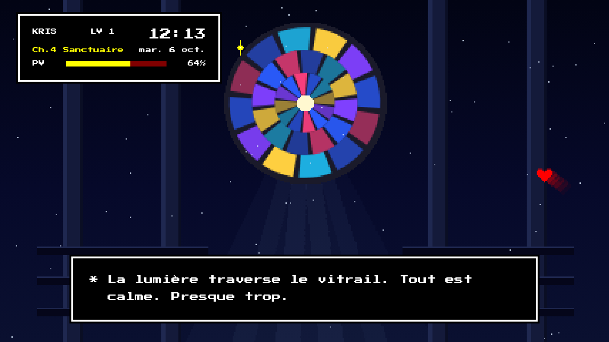 **Ch.4 Sanctuaire** |
| 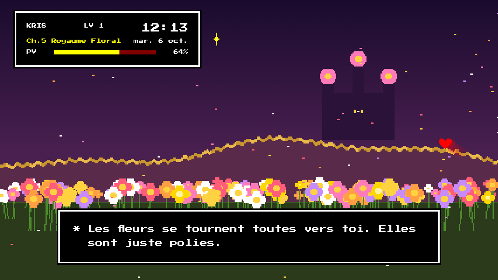 **Ch.5 Royaume Floral** | 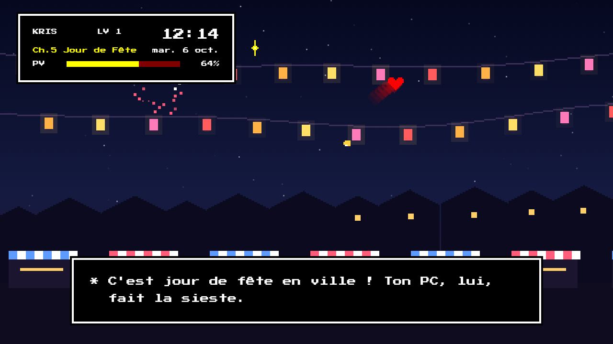 **Ch.5 Jour de Fête** |

Dans chaque scène :
- l'**âme** (cœur rouge) se balade à l'écran ;
- un encadré façon **fichier de sauvegarde** affiche l'heure, la date, le lieu et ta **batterie** sous forme de barre de PV (verte en charge, rouge et clignotante sous 20 %) ;
- une **boîte de dialogue** écrit des petites répliques lettre par lettre.

## Installation

Dépendances (déjà présentes sur une Ubuntu de bureau) : `python3`, `python3-gi`, `gir1.2-webkit2-4.1`.

```bash
git clone https://github.com/NelioMega/deltarune-screensaver.git ~/deltarune-screensaver
~/deltarune-screensaver/installer.sh
```

L'écran de veille démarre alors automatiquement à chaque connexion et s'affiche après **1 minute d'inactivité**.
Il se ferme dès que tu bouges la souris ou touches le clavier.

Pour le retirer : `~/deltarune-screensaver/desinstaller.sh`

## Comment ça marche

GNOME sous Wayland ne gère pas les écrans de veille personnalisés, donc :

- `lancer-veille.sh` interroge l'inactivité via le D-Bus de Mutter (`org.gnome.Mutter.IdleMonitor`).
  Il ne se déclenche pas si une application bloque la mise en veille (vidéo en cours, appel…).
- `veille.py` ouvre `veille.html` en plein écran sur chaque moniteur avec GTK + WebKit, envoie le niveau de batterie à la page et se ferme à la première interaction.
- `veille.html` contient toutes les animations (canvas en basse résolution, agrandi en pixels nets).

## Personnaliser

- **Délai avant le lancement** : `DELAI=120 ./lancer-veille.sh` (en secondes, 60 par défaut).
  GNOME éteint l'écran au bout de 5 min par défaut : augmente « Écran vide » dans *Paramètres → Énergie* pour profiter plus longtemps de l'animation.
- **Durée d'une scène** : `DUREE_SCENE` en haut du script de `veille.html` (180 s par défaut).
- **Répliques** : la liste `LINES` (communes) ou `lines` dans chaque scène.
- **Tester une scène** : ouvre `veille.html?scene=jardin` dans un navigateur
  (`fontaine`, `combat`, `plaine`, `chaos`, `foret`, `ville`, `spam`, `studio`, `plateau`, `sanctuaire`, `jardin`, `fete`).
- **Refaire les captures** : `brave --headless=new --window-size=1280,720 --screenshot=x.png "file://$PWD/veille.html?scene=fete&capture"`

## Crédits

Projet de fan non officiel. DELTARUNE est une œuvre de Toby Fox ; tous les graphismes ici sont redessinés à la main dans le code, aucun fichier du jeu n'est utilisé.
